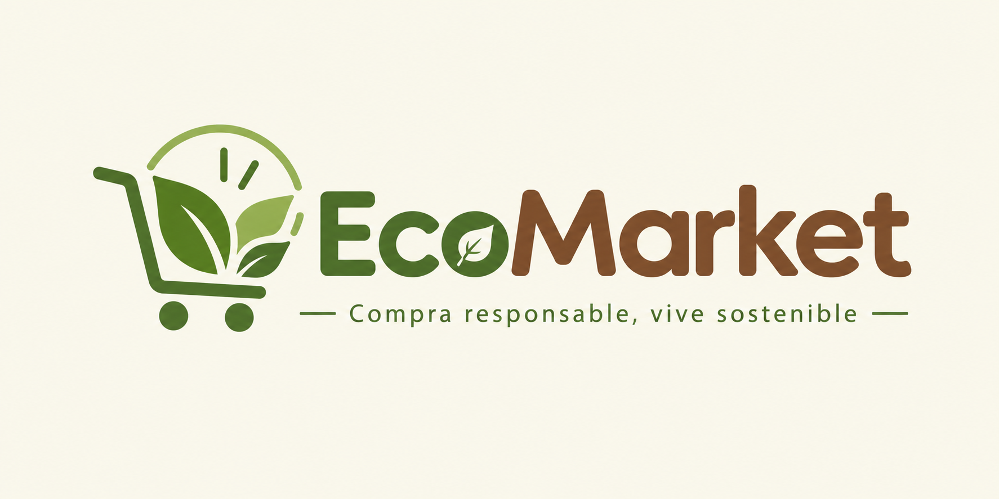
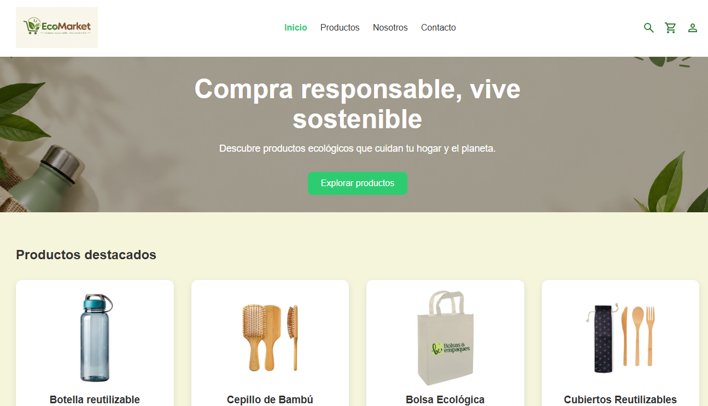
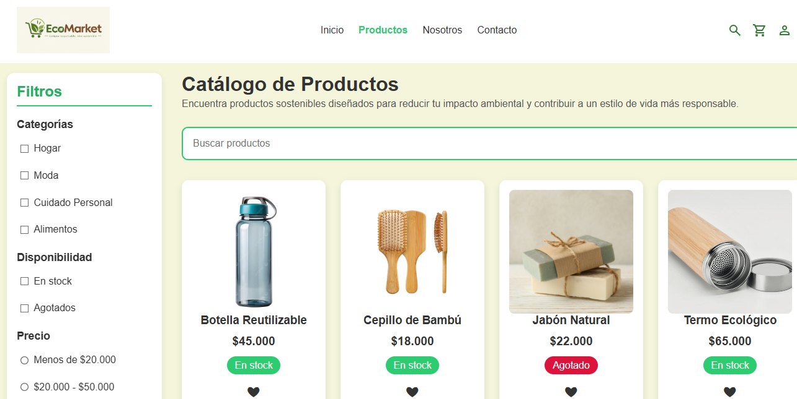
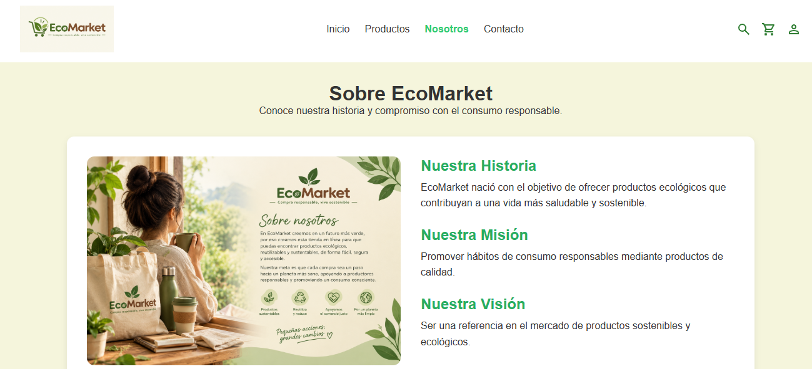
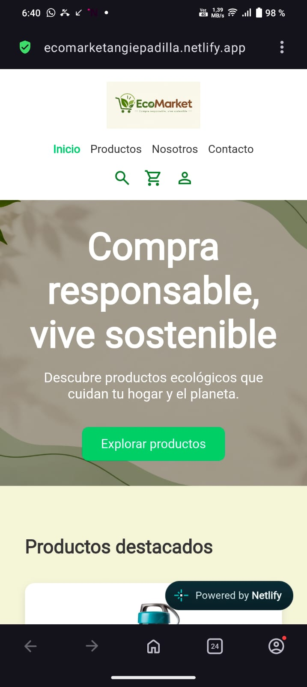
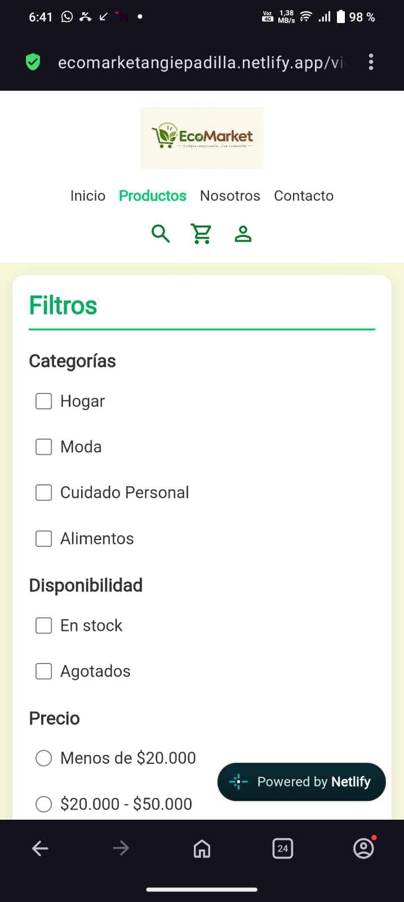
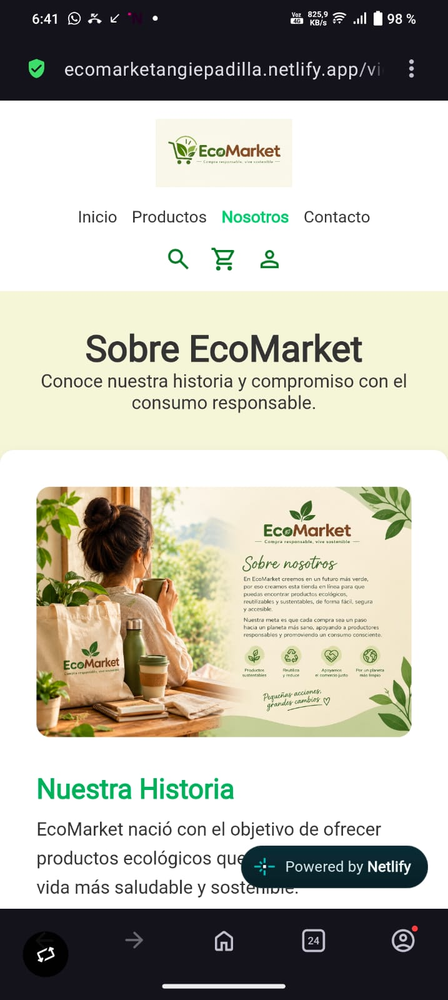
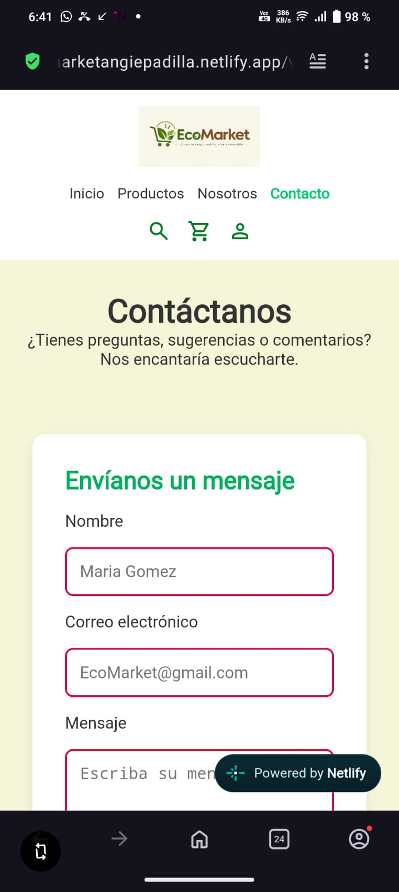

<p align="center">
  
</p>

# 🌱 EcoMarket

## 📖 Descripción del proyecto

EcoMarket es una página web dedicada a la promoción y comercialización de productos ecológicos y sostenibles. El sitio permite a los usuarios explorar un catálogo de productos organizados por categorías, consultar información relevante sobre cada artículo y conocer la filosofía de la marca.

---


## 🚀 Instrucciones de visualización y 🌐 Despliegue

Para facilitar el acceso al proyecto, la página fue desplegada utilizando **Netlify**. Una vez finalizado el desarrollo y almacenado el código en GitHub, el repositorio se conectó con la plataforma de despliegue para publicar automáticamente la aplicación en internet.

De esta manera, cualquier usuario puede acceder al sitio web desde un navegador sin necesidad de realizar instalaciones o configuraciones adicionales.

**Enlace de la aplicación:**

**https://ecomarketangiepadilla.netlify.app**

No se requiere instalación ni configuración adicional para acceder al proyecto.

---
## 📂 Repositorio

El código fuente completo del proyecto se encuentra disponible en GitHub y puede consultarse a través del siguiente enlace:

**Repositorio:**  
**https://github.com/Angiepad09/EcoMarket_AngiePadilla**

---

## 🛠️ Tecnologías utilizadas

### HTML5
utilizado para estructurar el contenido de la página web, incluyendo secciones, formularios, enlaces e información de los productos.

### CSS3
Lenguaje de estilos empleado para diseñar la interfaz, definir colores, tipografías, espaciados y mejorar la presentación visual del sitio.

### Flexbox
Módulo de CSS utilizado para organizar elementos en filas y columnas de manera flexible, facilitando la alineación y distribución de componentes.

### CSS Grid
Sistema de diseño bidimensional utilizado para construir estructuras complejas y adaptables, especialmente en el catálogo de productos y las diferentes secciones de la página.

### Media Queries
Técnica de CSS que permite adaptar el diseño a distintos tamaños de pantalla, garantizando una experiencia adecuada en dispositivos móviles y de escritorio.

### Git
Sistema de control de versiones utilizado para registrar y gestionar los cambios realizados durante el desarrollo del proyecto.

### GitHub
Plataforma utilizada para alojar el repositorio, gestionar las ramas del proyecto y mantener el historial de cambios.

### Netlify
Servicio utilizado para desplegar el proyecto y hacerlo accesible públicamente a través de Internet.

---

## 📁 Estructura del proyecto

```text
EcoMarket_AngiePadilla/
│
├── index.html
├── README.md
│
├── css/
│   ├── main.css
│   ├── layout.css
│   ├── components.css
│   └── animations.css
│
├── img/
│   ├── hero/
│   ├── icons/
│   ├── products/
│   └── capturas/
│
└── views/
    ├── productos.html
    ├── sobre-nosotros.html
    └── contacto.html
```

---

## ✨ Funcionalidades principales

- Página de inicio con presentación de la marca.
- Catálogo de productos ecológicos.
- Barra lateral de filtros.
- Búsqueda de productos.
- Etiquetas de disponibilidad de stock.
- Botón de favoritos mediante pseudoclases CSS.
- Diseño adaptable para dispositivos móviles, tabletas y escritorio.
- Navegación entre distintas vistas del sitio.
- Organización modular de estilos CSS.

---

## 📱 Diseño Responsive

La interfaz fue desarrollada siguiendo principios de Responsive Design, permitiendo una correcta visualización en diferentes tamaños de pantalla mediante el uso de Media Queries, Flexbox y CSS Grid.

---

## 📸 Capturas de pantalla

### 🖥️ Vista de escritorio

#### Página de inicio - `index.html`
<p align="center">
  
</p>


#### Catálogo de productos - `productos.html`

<p align="center">
  
</p>

#### Página Nosotros - `sobre-nosotros.html`

<p align="center">
  
</p>

#### Página Contacto - `contacto.html`

<p align="center">
  
</p>
---

### 📱 Vista móvil

#### Página de inicio - `index.html`
<p align="center">
  
</p>

#### Catálogo de productos -  `productos.html`

<p align="center">
  
</p>

#### Página Nosotros - `sobre-nosotros.html`

<p align="center">
  
</p>

#### Página Contacto  - `contacto.html`

<p align="center">
  
</p>

---

## 🔀 Control de versiones

El proyecto fue gestionado utilizando Git y GitHub mediante una estructura basada en ramas de características:

```text
main
│
├── feature/refactor-css
├── feature/catalogo
├── feature/nosotros
├── feature/contacto
├── feature/home
└── feature/readme
```

Además, se empleó la convención Conventional Commits para documentar el historial de cambios.

Ejemplos:

```text
style: refactorizar estructura CSS
docs: agregar documentación del proyecto
```

---

## 👨‍💻 Autor

Angie Padilla 

